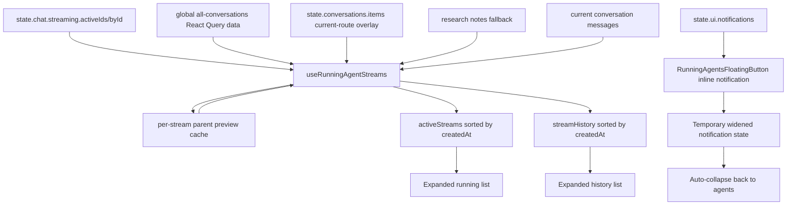

---
paths:
  - "client/ygg-chat-r/src/components/RunningAgentsFloatingButton/**"
  - "client/ygg-chat-r/src/hooks/useRunningAgentStreams.ts"
  - "client/ygg-chat-r/src/components/motion.ts"
  - "client/ygg-chat-r/src/features/chats/agentRunPreviewSlice.ts"
  - "client/ygg-chat-r/src/features/chats/mainChatClient.ts"
  - "client/ygg-chat-r/src/features/ui/runningAgentsUiSlice.ts"
  - "client/ygg-chat-r/src/components/GlobalNotifications/**"
  - "client/ygg-chat-r/src/features/ui/uiSlice.ts"
  - "client/ygg-chat-r/src/App.tsx"
---

# Agent Context: Floating Agent Button Design

Last reviewed: 2026-06-17

## Purpose

Documents the current floating agent/app button interaction pattern so future UI surfaces can reuse the same polished expansion/collapse feel without rediscovering the animation details.

Open this file when changing or borrowing the animation/style from:

- `client/ygg-chat-r/src/components/RunningAgentsFloatingButton/RunningAgentsFloatingButton.tsx`
- app-shell floating controls in `client/ygg-chat-r/src/App.tsx`
- any future compact-to-expanded pill, popover launcher, or inline notification surface.

## Key Files

- `client/ygg-chat-r/src/components/RunningAgentsFloatingButton/RunningAgentsFloatingButton.tsx` - canonical implementation of the style and animation.
- `client/ygg-chat-r/src/hooks/useRunningAgentStreams.ts` - stream view-model derivation for active/history agent rows.
- `client/ygg-chat-r/src/App.tsx` - mounts the floating button from `HtmlToolsShell` and wires the apps modal action.
- `client/ygg-chat-r/src/components/GlobalNotifications/GlobalNotifications.tsx` - completion timers without duplicate toasts; separately renders global error notices.
- `client/ygg-chat-r/src/features/ui/uiSlice.ts` - notification state shape used by inline stream-completion notifications.

## UX Intent

The floating agent button is a compact, fluid app-shell control. It should feel like one continuous object that changes shape rather than separate UI pieces appearing and disappearing.

Default/collapsed state:

- Shows the text `agents`.
- Shows a small status dot:
  - neutral when idle;
  - emerald when streams are active;
  - rose when an active stream has an error.
- Omits the apps-modal action; it appears only when expanded.
- The main `agents` area expands/collapses the running-agent panel.
- When expanded, the apps action opens/closes the HTML tools/apps modal.

Expanded state:

- The outer shell changes width/height using one symmetric CSS card-resize transition.
- The apps expand button stays visually pinned to the far right of the widened shell.
- The running-agent panel appears below the top row.
- The body is always the live grid (the list/grid switch and the old list view were removed). Forks sort active first, then by representative start time: newest active execution for active forks, newest-started completed execution for idle forks. How that order moves cards is governed by the grid card-movement setting (see "Grid card movement").
- Group runs by `(conversationId, server-confirmed lineageId)`; retain separate stream IDs for execution and replay. Initial source lineages and missing identities stay as individual unresolved runs until the server resolves them.
- Show one card per fork (`AgentForkCard`) with a stable shortened lineage label, and the latest active request/navigation target (no running/completed run-count summary). Idle cards use the latest completed run. Recent completed runs belong to their active fork's card rather than appearing separately.
- Compact/header counts describe active fork groups, while the accessible label also reports running executions. The component-local recent-run buffer is capped at 40; displayed history also merges inactive retained-preview metadata, then `limitFinishedAgentHistory` keeps only the newest `MAX_FINISHED_AGENT_FORKS` (5) finished forks (ordered by newest-started run). Completed runs of active forks are always kept and do not count toward the cap.

Notification state:

- Stream-completion notifications are repurposed into the same floating shell.
- On completion, the inner `agents` content is temporarily replaced by an inline completion notification.
- The shell widens smoothly, displays the notification, then collapses back to the normal `agents` state.
- Clicking a branch-completion notification dismisses it and opens that exact run's read-only preview inside the pill. Open chat is the explicit navigation action. Watcher notifications still navigate directly.

## Animation Recipe

The agent pill now uses the transitions.dev card-resize snippet in `agentsPillMotion.css`: one 300ms width/height transition with a local `ease-in-out` override so collapse is the time-reverse of expansion. `RunningAgentsFloatingButton.tsx` measures a natural-size inner content wrapper with ResizeObserver and adds the shell border to the target dimensions. The outer fixed shell alone interpolates; child controls, status dots, and request text are static. Pointer dragging and prefers-reduced-motion disable the transition. Saved custom expanded dimensions remain controlled by `useAgentsPillResize`.

The Framer recipe below is historical and no longer applies to this pill; do not reintroduce it:

Canonical transitions live in `src/components/motion.ts` (relative to the client):

- `shellSpringTransition`: spring, stiffness 340, damping 44, mass 0.86.
- `contentSpringTransition`: spring, stiffness 300, damping 40, mass 0.8.
- `softTransition` and `reducedMotionTransition`: 180ms, easeOut.
- `feedbackTransition`: 140ms, easeOut.

The component calls `useReducedMotion()` and `useMotionPreferences()`. Shell and
details-height transitions use `shellTransition`; content swaps use
`contentTransition`; icon feedback uses `feedbackTransition`. Reduced motion
resolves these to the 180ms ease-out token. There is no separate collapse token.

Important animation rules:

- Expansion and collapse should use the same spring. Do not make collapse a separate tighter spring unless the design deliberately wants a different close feel.
- Use `layout` on the outer fixed wrapper and inner shell.
- Use `AnimatePresence mode='popLayout'` for content swaps and details panel enter/exit.
- For vertical panel expansion, animate a details shell from `height: 0` to `height: 'auto'`, with `overflow-hidden`.
- For content inside the height shell, use a separate inner motion layer for opacity/y/scale so the height animation remains clean.
- Add `will-change-[width,height,transform]` to the animated shell for smoother browser compositing.
- Avoid mixing CSS `hover:scale-*` with Framer `layout` on the same button. That caused back-and-forth jitter on the apps button. Prefer color-only CSS transitions or Framer-only transforms.
- The apps action is a plain button. Keep hover feedback color-only; do not animate entry/exit or icon transforms.

## Layout Rules

Top row:

- Use a full-width flex row: `flex w-full items-center justify-between`.
- Left/main content is either:
  - compact `agents` control; or
  - inline notification content.
- Expanded right actions contain the apps button and, with developer logs enabled, branch diagnostics. Collapsed/inline-notification states omit these actions.
- The apps expand button must be `shrink-0` so it stays pinned to the far right as the shell widens.

Shell:

- Fixed-position app-shell control, currently mounted around bottom-right.
- Rounded shell: `rounded-[28px]`.
- Disabled-theme fallback: `bg-white/75`, `dark:bg-yBlack-900/75`, `backdrop-blur-2xl`.
- The existing shell retains a border/drop shadow, not a shared requirement for new UI.
- Preserve `useCustomChatTheme()`, `useHtmlDarkMode()`, and `getThemeModeColor()` integration for shell, text, badges, status, hover surfaces, and controls.
- Enabled-theme shell borrows `streamingAnimationColor` for both its radial tint (18%) and linear tint (22%), over the settings card fill (78%). This follows the active theme's light/dark agent-activity color rather than settings-panel button/accent colors. Transcript and request tooltips also consume custom-theme/light-dark state.

Header actions (expanded, left to right): "N hidden" toggle (only while forks are hidden), Grid settings (gear), Group steps (Layers), branch diagnostics (dev logs only), apps.

## Data Flow

## Accessibility and Interaction

- Main compact control should expose `aria-label` based on active stream count, or the notification title when notification content is showing.
- Use buttons for clickable rows and notification content.
- Clicking a stream/history row opens its read-only run preview inside the floating shell. Open chat uses the central chat-navigation facade. Confirmed fork identity opens `/chat/:projectId/:conversationId/lineage/:lineageId?focus=messageId`; legacy/unconfirmed runs retain message-hash navigation. Repeated Open chat clicks are fresh selection intents.
- Clicking a branch-completion notification opens the in-pill preview using its `streamId`, not the latest run in the conversation. If that transcript was superseded, show the existing unavailable-preview message with Open chat targeting the notification's response. Watcher notifications retain direct navigation.
- Respect reduced motion via `useReducedMotion()` and fall back to short opacity/timing transitions.

## Gotchas

- Do not reintroduce a separate visible toast for stream-completion notifications unless product wants duplicate notification surfaces.
- `GlobalNotifications` auto-dismisses `ui.notifications` after 8 seconds without duplicate completion toasts. It returns `null` only without `ui.errorNotices`; otherwise it renders separate bottom-left `ChatErrorBubble` notices. Preserve that error surface.
- If multiple notification types are added, decide whether they should all appear in the floating button or only `branch_stream_completed`.
- The apps button uses a plain button. Preserve color-only CSS hover feedback and test custom-size expansion/collapse for jitter.
- The compact top-level label remains `agents`. Group rows use a shortened durable lineage ID rather than positional `agent-1` / `agent-2` labels, which would change when sorting changes.

## Validation

- Run `npm --prefix client/ygg-chat-r run build:electron` after changes.
- Manual checks:
  1. Idle collapsed state shows `agents` and neutral dot.
  2. Active work shows the active dot; `+N` counts additional active fork groups, not multiple executions on one fork. Custom themes may override emerald.
  3. Expanding and collapsing feel like reverse directions of the same motion.
  4. Apps action appears far right only when expanded, not collapsed/inline-notification states.
  5. Stream-completion notification widens the shell, then returns to `agents` state.
  6. Clicking a branch-completion notification opens its exact run inside the pill without changing route; Open chat navigates to the completed response. Watcher notifications still navigate directly.
  7. Active and history lists scroll and remain sorted by the latest run's start/created time.
  8. Consecutive sends on one fork reuse one group; sibling forks remain separate, including while their server identity resolves.
  9. Expand recent runs and navigate to individual run targets; a fork with multiple active executions counts as one fork.

## In-pill run transcript previews

The selected run expands the shell vertically into a bounded, scrollable transcript with Back, an independent Group steps toggle, and Open chat. Completion notifications do not collapse an open preview. Auto-follow pauses when the user scrolls away from the bottom; Jump to latest resumes it.

`features/chats/agentRunPreviewSlice.ts` is renderer-session Redux state, separate from normal stream slots and Query snapshots. Synchronous middleware captures reduced live tails before subsequent actions can reset a turn. `mainChatClient` captures normalized `messageAdded` projections with their stream ID before the visible-conversation guard, for initial reads and reattach. Complete-chunk capture also supports direct tool/subagent clients. Persisted messages upsert by ID; enriched results supersede old streamed placeholders. The main server loop emits each first assistant persistence before the next turn boundary, and re-emits enriched rows under the same ID. Claude instead re-persists one API message per completed block, with a turn boundary before each later text/thinking block; when the stream's `persistedTurnMessageId` names an existing entry, its message-less live entry is folded into it rather than rendered again (regression: `agentRunPreview.test.ts`, "folds Claude per-block re-persistence").

Keep all active runs, then only the newest-started retained run per confirmed `(conversationId, lineageId)`. `reconcileRetention` also deletes every retained run of finished forks beyond the newest `MAX_FINISHED_AGENT_FORKS` (5); a fork with any active run is never evicted. Evicted runs are not recreated by late non-start events. Unconfirmed runs remain stream-scoped. A newer run releases superseded inactive payloads; an older simultaneous run completing later cannot take latest ownership. Stream pruning, navigation, collapse, and widget unmount do not clear retained previews. Renderer reload and `users/clearUser` do. A recovery starting from a later cursor is labelled potentially incomplete rather than presented as a full archive.

`useRunningAgentStreams` merges retained latest metadata into history, so retained forks remain discoverable even after its component-local 40-row recent-run list is lost or capped. Older run metadata can remain without a transcript; the preview explains this and offers Open chat.

`AgentRunPreview.tsx` uses `agentPreviewContent.ts` to combine adjacent assistant turns into a presentation row. This reuses ChatMessage's existing process grouping across turn boundaries without moving the large Chat container row pipeline. The independent toggle starts from `chat:groupToolReasoningRuns`, never writes it, and remains local to the floating widget. Text blocks always break groups in this preview; normal chat separator behavior is unchanged. Stable group keys preserve expansion as new steps append.

Preview tool cards reuse normal chat presentation for structured inputs/results (including multi_call), edit diffs, and plan_md display. Plan viewing uses the retained Markdown snapshot, with fullscreen and zoom available but Edit/Save and saving shortcuts blocked. Fullscreen plans layer above the pill and consume Escape without closing the underlying transcript. Executable HTML/MCP apps, app loaders, tool-navigation and subagent-transcript actions remain disabled. Copyable prose and disclosures remain available; editing/branching actions are disabled. Duplicate tool_failed bubbles are omitted from preview presentation; failed tool results and other error bubbles remain visible. Tool output truncation affects rendering only, not retained content. Archive memory is bounded to active forks plus the 5 newest finished forks, but individual very large runs are not truncated.

User rows in the transcript use the pill-only theme key `agentsGridUserMessageBg` through `ChatMessage`'s `userSurfaceColor` prop. Chat's user surface (`messageRoles.user.containerBg`) blends into card backgrounds. The default is `color-mix(in srgb, currentColor 7%/10%, transparent)`, a tint of the card's own text colour, so it stands out on any card colour. The same default applies when custom themes are off. Edit it in Theme Manager → Agents pill grid cards. The key exists in both `themeConfig.ts` and `server/tools/themeManager.ts`.

Validation: `npm run test:renderer`, `npx tsc -p tsconfig.app.json --noEmit`, and `npm run build:electron` from the client directory. Manual checks must include background runs, multi-turn tools, completion/pruning/reopen, same-fork replacement, Stop all, grouped/ungrouped prose, notification coexistence, and Open chat.

Fork labels display only the first three lineage-ID characters (`fork 5d1`); grouping still uses the complete identity. Parent-request ticker and recent-run request rows show the full message on hover/focus in `AgentMessageTooltip`, portalled outside the shell's clipping containers. The tooltip preserves line breaks, is scrollable for long requests, and uses explicit light/dark/custom-theme colors. Escape, underlying scroll, and navigation dismiss it.

Grid cards and selected-run previews reuse Chat's `StreamingThinkingIndicator` with `compacting` while an active retained run has `compactionStatus === 'started'`. The compaction shimmer/progress bar replaces normal streaming feedback; completion/failure restores the existing activity state. Whole-fork previews check all retained same-fork runs, not just the representative; sibling forks and inactive history never borrow another run's animation.

The run viewer and request previews share Heimdall's `isHeimdallScaffoldingMessage` semantic filter: context-injection and operation-mode reminder rows are hidden from presentation, not deleted from retained state. Automated completion user rows (`meta.kind = watcher_completion`: watcher, `subagent_manager` and `claude_bridge` results) are never used as a fork's request text; the run viewer renders them as Chat's compact `WatcherCompletionNotice` (`PreviewRow.watcherCompletion`) instead of a user bubble. The preview cannot rely on `ChatMessage`'s own notice guard because preview IDs (`agent-preview:…`) never match a Redux message. Compaction summaries carry a presentation-only flag and render the shared `SummarisedMessage` notice with its Archive icon, “Conversation summarised” label, shared CSS layout and custom-theme muted color. Raw summary content/blocks never reach the preview renderer; retained canonical entries remain unchanged. Unlike graph empty-node promotion, the transcript keeps real reasoning/tool-only turns so live agent work remains inspectable.

## Expanded size (renderer-session only)

Expanded grid and transcript modes share a top-left corner resize handle; the bottom-right anchor stays fixed. `useAgentsPillResize.ts` owns transient pointer capture and animation-frame geometry, while `features/ui/runningAgentsUiSlice.ts` stores the preferred total expanded width/height only on release or keyboard resize. No localStorage/Query/disk persistence. Collapse/reopen and fullscreen-homepage unmount/remount preserve size; renderer restart, sign-out, or reset clears it.

Drag left/up to grow, right/down to shrink. Arrow keys resize by 8px, Shift+arrows by 32px; Home or double-click restores automatic sizing. Pointer cancellation restores the prior preference. Viewport/anchor changes clamp the rendered size while preserving the preferred dimensions for a later larger window. The transcript flex-fills the available body. The CSS width/height transition is disabled during active dragging.

Validation includes `agentsPillResize.test.ts` (geometry and session state), the renderer suite, and Electron build. Manual checks: drag while streaming, release outside the handle, pointer cancellation, viewport shrinking/restoration, grid/transcript switch, collapse/reopen/remount, keyboard/reset, and theme/reduced-motion behavior.

## Row-specific grid splits

`AgentsMonitorGrid.tsx` measures available width and retains the responsive one/two/three-card cap and 18rem automatic card target. Each row renders independent tracks in `AgentGridRow.tsx`. Drag the full-height empty gutter to trade width only between adjacent cards in that row; other rows and a third card keep their ratios. No dependency or disk persistence is involved.

Rows retain ratios while mounted with unchanged membership. Membership changes reset that row to equal widths; surviving cards in the same row retain their React identity. Cards moving between rows remount. Collapse, switching away from the grid, or renderer reload resets splits. An incomplete last row fills its available width. CSS enforces a 160px minimum while resizing the outer pill; one-column cards still fit narrower containers. Track weights are normalized so every track is at least 1fr: fractional weights below 1fr can leave unused row space when another card reaches its minimum. There is no per-card maximum-width cap. Pointer capture, animation-frame updates, cancellation, and cleanup live in the row component; `agentGridSplit.ts` contains pure responsive-count and neighboring-pair geometry.

Keyboard: focus a gutter and use Left/Right (8px), Shift+Left/Right (32px), Home to equalize the row, or Escape to cancel a drag. Double-click a gutter also equalizes its row. Manual validation: independently resize two rows, move both dividers of a three-cell row, release outside the pill, cancel a drag, resize the outer pill across breakpoints, and verify live transcript scrolling, custom themes, and single-cell rows. Automated coverage lives in `AgentGridRow.test.tsx` and `agentGridSplit.test.ts`.

## Compact bootstrap recovery

The pill must consume all exact run-scoped `snapshot.persisted` rows, not only `snapshot.events`: the latter intentionally retains only prior-anchor/current-turn projection. `mainChatClient` calls preview `bootstrapReceived` before replay and the preview middleware finishes at `streamBootstrapReconciled`. Durable rows are ordered parent-first and replace obsolete/deleted rows; current transient output is rebuilt once without overwriting an earlier entry. Live capture is suspended during installation, then late results and future boundaries resume normally. The starting anchor is excluded only when not itself emitted as a run message. This is separate from Chat's selected-path recovery and works while another conversation is selected. Regression: `agentRunPreviewReconnect.test.ts`, using the real server projector and SSE reader.

## Grid transcript rendering budget

Grid card height fills the grid scroller's inner height (`max(16rem, <measured>px)`), so one row occupies the pill and further rows are reached by scrolling; before measurement the old static `dvh`/`rem` height is used. The scroller is measured on mount, once when a pill drag ends (`resizing` = `pillResize.dragging`), and after other resizes settle (150ms debounce), never per drag frame. Grid cards keep their fixed-height shells, headers, navigation and row split controls mounted. One `IntersectionObserver` rooted at the outer grid scroller mounts full `AgentRunPreview` transcripts only for visible rows plus a 200px prefetch margin. Unsupported observer environments render all transcripts. An offscreen row containing keyboard focus stays mounted until focus leaves; per-fork scroll position and paused auto-follow survive transcript unmount/remount. The pill owns that scroll map (`AgentsMonitorGrid` `scrollStates` prop), so positions also survive opening a focused preview and pressing Back, and collapsing the pill. Column-count changes invalidate the old visibility indexes before the new observer reports. Collapse still unmounts the grid and resets row splits; captured transcript data is never evicted by scrolling or collapse.

`AgentRunPreview` is memoized and selects a stable readonly array of only its run/fork. A WeakMap shares a fork index per immutable preview-map snapshot, avoiding a full-map scan per card. Unrelated stream updates do not rebuild visible transcripts, including when parent metadata rerenders. The selected full-run viewer is not visibility-deferred. Find-in-page and screen-reader transcript browsing only cover mounted transcript bodies; all fork headers and explicit full-preview navigation remain available. Individual very large visible transcripts can still be expensive; this change bounds cards, not message rows within one transcript.

Validation: agents-pill unit coverage plus `node scripts/test-agents-grid-electron.cjs`. The isolated real Chromium fixture uses 120 forks, real grid/preview/Redux/observers with lightweight message presentation, and checks bounded mounts, unrelated/visible stream updates, parent rerenders, outer scrolling, retained reading position/focus, responsive columns and StrictMode collapse/reopen. It does not establish a real-user latency benchmark for full markdown/tool rendering.

## Hiding the run open in Chat

The pill omits the fork Chat is currently showing, live or finished, so it never repeats what is already on screen. `RunningAgentsFloatingButton` resolves it only while the route is `/chat/...` and `chat.selection.status` is neither `pending` nor `error`; the selection survives leaving Chat (e.g. Settings), where the fork must be listed again. Two inputs feed `excludeViewedAgentFork` (`useRunningAgentStreams.ts`): the viewed branch's fork key (`getLineageForkKey(currentConversationId, currentLineageId)`), which hides finished forks too, and the live run from `selectCurrentViewStream` (active streams only), which still hides that run while its lineage is unconfirmed. Every active and completed run with either key is removed, so the fork never shows as completed while it runs on screen, and a finished viewed branch does not reappear under History. Unconfirmed completed runs keep their run-scoped key and stay listed. Counts, status dot and grid use the filtered lists; the selected-run lookup, notification previews and branch diagnostics keep the unfiltered lists. Presentation only; execution, cancellation and replay are unchanged. Known, accepted gaps: Chat's local pending stream at send start may flash in the pill, and parallel-pane runs are not hidden. Tests: `useRunningAgentStreams.test.ts` (`excludeViewedAgentFork`).

## Empty and user-hidden grid cards

The grid omits a finished fork with nothing a reader can see. That covers a released transcript (no retained representative) and runs whose rows are only empty or whitespace text/thinking. Forks with a running stream always stay, because their card shows the working animation while waiting for output. `forkHasPreviewContent` (`agentForkPreview.ts`) uses the same whole-fork lookup as the card, and caches by run object (Immer replaces a run when it changes). `useAgentGridForks` (`AgentsMonitorGrid.tsx`) owns this membership for both the grid and the header toggle; it selects a serialized list of empty IDs, so token updates do not rerender either. Selected-run previews are unchanged.

Each card has an EyeOff hide control. `runningAgentsUiSlice.hiddenForks` stores fork key → stream IDs known when hidden. The data is session-only, capped at 200, and cleared on sign-out (not by pill size reset). A fork stays hidden until it gains a run the user had not seen, so new activity on a hidden fork resurfaces it. Hidden forks appear behind an "N hidden" toggle in the expanded pill header, left of Group steps; it shows only while the grid (not a preview) is open and something is hidden. The toggle opens an inline list above the cards (status dot, name, fork, status) with a per-row Show control and Show all. Escape closes the list and returns focus to the toggle. Hiding focuses the toggle, and showing focuses the restored card. Colours: `settingsCustomThemesButton*` for the toggle and row controls, `composerToggleActive*` for the open toggle, and `settingsCustomThemesInnerCardBg` for the list surface. Tests: `AgentsMonitorGrid.test.tsx`, `runningAgentsUiSlice.test.ts`.

Cards also have a collapse control (ChevronsRightLeft) left of hide. A collapsed card becomes a fixed `3rem` strip showing an expand button, a status dot and a vertical name/fork button that opens the preview. Its transcript unmounts, and scroll state is kept. The open cards in that row share the remaining width. `runningAgentsUiSlice.collapsedForks` holds fork keys for the session (capped, cleared on sign-out). `getEffectiveCollapsedCells` only applies a collapse while another card in the same row stays expanded; an all-collapsed or single-card row renders expanded, so the control is offered only when more than one card in the row is expanded. `AgentGridRow` takes per-cell `collapsed` flags. `getAgentGridTracks` gives collapsed cells the fixed track and normalizes open cells among themselves. Collapsed cells get no splitter and are excluded from split width, and a collapse change re-equalizes the row the same way a membership change does. Focus moves to the replacement toggle after collapse or expand. Tests: `agentGridSplit.test.ts`, `AgentGridRow.test.tsx`, `AgentsMonitorGrid.test.tsx`, `runningAgentsUiSlice.test.ts`.

## Shared fork card (grid and focused preview)

`AgentRunCard.tsx` is the shared visual card for pill forks and expanded subagent runs; `AgentTranscriptRows.tsx` renders their read-only message rows. Subagents adapt their dedicated transcript and child stream directly, without creating pill preview entries or exposing fork actions. `AgentForkCard.tsx` is the only fork view in the pill. Grid cells and the focused preview (opened from a card title, a list row, a recent-run row or a completion notification) both render it, so they cannot drift. It owns the header (title row: name, fork, Open chat, then caller actions; status row: dot and label), the request line and the `AgentRunPreview` transcript. Callers only add controls: the grid passes `onOpen` (title becomes the Preview button) and collapse/hide `actions`; the pill passes a Back icon button as `leading`. The collapsed grid strip and the hidden list stay grid-only but use the same status and theme helpers.

`getAgentCardStatus` derives one status from the stream list (`AgentForkGroup`). Its label is `Running`, `Completed` or `Ended with error`; it never names the current tool or activity. It drives the header and the transcript's `isStreaming`, so the working indicator always agrees with the header. Do not derive it from the preview store: a stream can end without the store seeing it (for example `sendingCompleted` without a stream ID). Render `AgentRunPreview` only through the card. `useAgentCardTheme` holds the shared theme keys (`toolJobsMutedText`, `agentsGridStreamingCardBg`/`agentsGridIdleCardBg`, `toolJobsProgress*`, `settingsCustomThemesButton*`, `settingsCustomThemesInnerCardBg`).

`resolvePreviewFork` finds the selected run's fork in the unfiltered lists, so a focused fork preview follows the live representative and counts as runs start and end. A run that is no longer listed (e.g. from an old notification) is shown as its own one-run group. With `run` set (recent-run rows and notifications), the card shows that one run: its own status, request and `Run <id>`, and no working indicator borrowed from a sibling run of the fork. Tests: `AgentForkCard.test.tsx`.

## Follow-up draft handoff to Chat

`AgentFollowUpComposer.tsx` shows its error (a rejected send such as "Branch advanced; reload before sending", or a `followUpTarget` reason) with an Open chat link. Clicking it dispatches `moveFollowUpToComposer` (`features/chats/agentFollowUp.ts`) before navigating. The draft text is appended to `chat.composition.input.content` after a blank line, and the pill draft is emptied, so the text lives in one place. `ChatInputController` picks it up because it resets to `initialValue` whenever that changes. Nothing moves while a send is preparing or sending, or when delivery is `unknown`, because the host may already hold that message. The card header's Open chat ↗ does not move drafts. Tests: `agentFollowUp.test.ts` (`moveFollowUpToComposer`).

## Chat/Agent mode per card

The follow-up composer has a Chat | Agent toggle left of Send. It shows the card's draft choice, else a pending live switch for that run, else `forkOperationMode` (the newest run's `operationMode`, which `useRunningAgentStreams` copies from `StreamState.operationMode`). Runs report their mode in the `started` SSE event (`streamOperationModeObserved`), and live switches and mode notices update it. The toggle is disabled whenever the composer cannot send (`followUpTarget` reason, send in flight, another draft unresolved) and while a live switch is still being requested.

`selectAgentFollowUpMode` (`features/chats/agentFollowUp.ts`):

- **One live run:** calls `changeOperationMode` with that run's stream, the same route as Chat's toggle. Nothing is stored on the draft.
- **Finished fork, or the live switch failed because the run just ended:** stores `operationMode` on the draft (`followUpModeChanged`). `submitAgentFollowUp` puts it on the attempt and `enqueueUserMessage` sends it to the queue route. The host's follow-up run starts in that mode and drops Claude's native plan mode. The mode is part of the submission fingerprint, so a retry cannot change it. Accepting the send clears the draft mode. Empty drafts that hold only a mode are not reclaimed.

Pending live switches are keyed per run (`operationModeChangeKey(conversationId, streamId)`), so two forks of one conversation can switch independently. A switch on a run whose confirmed lineage is not the one open in Chat does not move Chat's composer mode (`streamShowsInView`). Tests: `agentFollowUp.test.ts` (Chat/Agent mode), `changeOperationMode.test.ts`, `sseProjection.test.ts`, server `messageInputQueue.test.ts` and `messageQueueRoutes.test.ts`.

## Grid card movement

Re-sorting must never shuffle the cards of a row the user is reading. `AgentsMonitorGrid` lays rows out with `arrangeAgentGridRows` (`agentGridLayout.ts`), starting from the previously rendered rows (held in a ref and updated in a layout effect):

- `rows` (default, "Move between rows"): row membership follows sort order, so a fork that becomes active rises to the top row. Inside a row, cards that were already there keep their slot; a card arriving from another row takes the slot of the card that left. A sort change inside one row changes nothing. When a row shrinks, survivors keep their relative order.
- `locked` ("Lock positions"): sort order is ignored. Departed forks leave a gap that the rest of their row absorbs (the row gets fewer, wider cards), rows that become empty are removed, and new forks are appended to the last row, then new rows.

The column count is the width capacity (`getAgentGridColumns` with an unbounded count), not `min(capacity, forks)`, so a fork arriving or leaving does not reflow every row. A capacity change (pill or window resize) reflows: `rows` from sort order, `locked` from the previous order. Card React keys are fork keys, so a card that stays in its row keeps its transcript mount and scroll; one that changes rows remounts, as before.

The mode is picked from the Grid settings gear in the header (left of Group steps). The menu is a `menuitemradio` list portalled to `document.body` (the shell clips), closed by outside pointer, Escape (focus returns to the gear) or window resize; Up/Down move between options. The choice persists in `localStorage` key `agents:gridOrderMode` (invalid values fall back to `rows`). Tests: `agentGridLayout.test.ts`, `AgentsGridSettings.test.tsx`.

## Quiet phone header presentation

`HtmlToolsShell` still owns one agents controller. `AgentsHeaderProvider` holds only ephemeral DOM targets; `ConversationToolbar` registers launcher/notice slots outside its rename branch when both the primary pane is compact and the viewport is a phone. The owner portals an icon/count and the current completion notice there. The phone header stays visible; no target (new chat/non-chat/desktop) retains the floating fallback.

Compact mode keeps controller state and uses the existing expanded content in a viewport-bounded dialog, disabling `useAgentsPillResize` through its enabled argument rather than conditionally calling hooks. Desktop dimensions are neither applied nor written. The shell remains mounted; Close/Escape restore focus to the launcher or Add. Completion notices remain actionable through the same openNotification path and existing timers, with no second notification owner. New compact-shell motion uses the approved transitions.dev modal timing; desktop pill resize motion remains unchanged.

## OS system notifications

The pill animation stays the in-app surface. Run completions also raise a native OS notification (macOS Notification Center, Windows toast, libnotify on Linux) through Electron's `Notification`.

- **Which runs:** main Chat runs (`streamType: 'primary'`) and branch runs. Watcher, subagent and tool completions never raise one. The `streamCompleted` listener in `src/store/store.ts` calls `buildSystemRunNotification` (`features/chats/systemRunNotifications.ts`) with the stream as it was *before* the action, so a slot that had already finished does not notify again. A reattach after a renderer reload rebuilds its slot as active, so that replay is caught by main's de-duplication instead (below). After a full app restart, a reattached run that finished while the app was closed can notify once. Errors and Stop never dispatch `streamCompleted` with a stream ID, so they never notify.
- **Content:** title is the conversation title (fallback `Graviton`); body is `Response finished` or `Branch run finished`. No response text, because the notification can appear on a locked screen.
- **Settings:** Settings → System notifications (`components/SettingsPane/SystemNotificationSettings.tsx`). An on/off switch (default on), a choice between `Only when Graviton isn't focused` (default) and `Always`, and a Send test button. localStorage keys `notifications:runCompletion:enabled` / `notifications:runCompletion:when` (`features/ui/systemNotificationPrefs.ts`), read at completion time. Hidden in the browser shared UI (no preload).
- **Main process:** `electron/systemNotifications.ts` validates the payload, applies the focus gate (`BrowserWindow.getFocusedWindow()`), and de-duplicates by `run-complete:<conversationId>:<messageId>` for 6 hours. The key is response-based, so the main and floating windows observing one run produce one notification, and main (which outlives renderer reloads) absorbs replays. It keeps each `Notification` referenced until click/close, since a collected object loses its click event.
- **Click:** main restores and focuses the main window (creating it if needed), parks the payload and sends `notifications:activated`. `useSystemNotificationActivation` (mounted once in `App.tsx`, so it works while the pill is unmounted) calls `takeActivation`, dismisses the matching in-pill branch notification, and navigates through `useChatNavigate`: confirmed fork → `/lineage/:id?focus=`, otherwise `#messageId`. Taking the payload is exactly-once, so a window still loading picks it up on mount.
- **Platforms:** Windows needs the AppUserModelId (`com.graviton.chat`, set in `main.ts`) to match the installer shortcut; dev-mode toasts may not appear. Unpackaged macOS builds show as "Electron". Ubuntu needs a notification daemon (GNOME Shell); `Notification.isSupported()` false reports `unsupported` to the Settings test.

Tests: `systemRunNotifications.test.ts`, `systemNotificationPrefs.test.ts`, `server/__tests__/systemNotifications.test.ts`.

## Detached agents window

The expanded pill header has an Open in new window button (ExternalLink, left of apps; Electron main window only, `canOpenAgentsWindow`). It calls `window:openAgents`, which opens or focuses one framed `Graviton - Agents` window loading the same bundle at `#/agents-window` (`electron/main.ts` `createAgentsWindow`), then collapses the pill. `App.tsx` renders only `containers/AgentsWindow.tsx` there: `RunningAgentsFloatingButton presentation='window'`, always expanded, filling the viewport (flex layout, no measured shell size), with no resize handle, apps or pop-out button. `src/platform/agentsWindow.ts` holds the route and IPC helpers.

The window has its own Redux store, so it gets runs from the host:

- **Live runs.** `useHostAgentRunSync` (called by `useRunningAgentStreams`) attaches a reader to every `/api/host/runs` run through `resumeInFlightStreams`, in the agents window only. Previews then fill from the run bootstrap as usual.
- **Finished runs.** Every host client (main window too) polls `GET /api/host/runs/finished` every 5 s. `pickFinishedRunsToInstall` takes the newest run of each of the newest `MAX_FINISHED_AGENT_FORKS` forks, skipping forks with a live run, forks whose retained run is as new, and runs already tried. `GET /api/host/runs/:streamId/transcript` returns the run's current rows, installed by `agentRunPreviewActions.finishedRunInstalled`. Each run is tried once per renderer, so retention can release it without a reinstall loop. So the main window also lists finished forks again after a reload. The host keeps this list in memory: an app restart forgets it.

Open chat (card header, notifications, composer error link) goes to the main window: `window:openInMain(href)` stores the route, focuses (or recreates) the main window and pings it; the main window takes it with `window:takeNavigation` on the ping and on mount (`AgentsWindowNavigation` in `App.tsx`), so a loading window cannot miss it. Only in-app routes are accepted. In the agents window the composer's error Open chat does not move the draft (that window's Chat composer is never shown). Each window keeps its own session UI state (hidden/collapsed forks, drafts, grid splits).

Tests: `finishedAgentRuns.test.ts`, `RunningAgentsFloatingButton.test.tsx` (window presentation), server `runSessionRegistry.test.ts`, `runSnapshotProjector.test.ts`, `finishedRunsRoutes.test.ts`.
